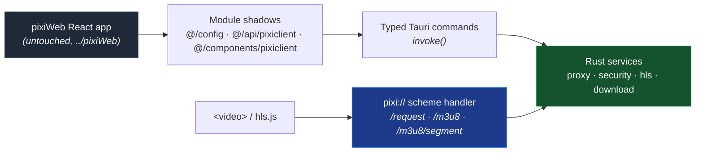

<div align="center">


# PixiAnime Desktop

**A native desktop client for PixiAnime — built with Tauri 2.**

[](https://github.com/pixiAnime/pixiDesktop/actions/workflows/ci.yml)
[](https://github.com/pixiAnime/pixiDesktop/actions/workflows/release.yml)

`Tauri 2` `Rust 2021` `Vite 8` `TypeScript 6` `Tailwind 4` `pnpm`

</div>

---

## What is this?

PixiAnime Desktop is the **desktop shell** for the PixiAnime web client. The user interface is the
web client's own React source, used unmodified — this repository supplies everything a browser
cannot:

- 🛡️ **SSRF-guarded upstream HTTP** — the renderer has no network access at all; Rust re-validates
  every request against private-range, link-local and metadata targets, on *every* redirect hop.
- 📺 **HLS rewriting in Rust** — M3U8 playlists and segments are rewritten to an app-private URI
  scheme, so the webview never talks to the internet directly and seeking (`Range`) keeps working.
- 💾 **Stream → Downloads** — one click saves the stream currently playing to `~/Downloads`, safely,
  with collision-proof naming and atomic writes.
- 🔒 **Hardened CSP** — a single explicit policy, shipped byte-exact, that keeps the extension
  sandbox functional.

> **🚧 Early software — v0.1.0.** Verified on Linux; Windows and macOS builds are produced by CI
> but have not been hand-QA'd. See [Known limitations](#known-limitations).

## Architecture

The shell swaps exactly three modules out of the web client. Everything else is the original source.



| pixiWeb import | Desktop replacement | What changes |
| --- | --- | --- |
| `@/config` | `src/shadow/config.ts` | protocol base + `isDesktop` |
| `@/api/pixiclient` | `src/bridge/` | localhost socket → Tauri commands |
| `@/components/pixiclient` | `src/shadow/components-pixiclient/` | offline dialog → Save button |

Because the aliases and the TypeScript `paths` point at the same files, `pnpm check` type-checks the
web client's own imports against the desktop shadows — **export-surface drift fails the build.**

## Quick start

`pixiDesktop` requires its sibling web client at `../pixiWeb`. Clone them side by side:

```sh
git clone https://github.com/pixiAnime/pixiDesktop.git
git clone https://github.com/pixiAnime/pixiWeb.git ../pixiWeb

cd pixiDesktop
pnpm install
pnpm install --dir ../pixiWeb     # react + types resolve from here
pnpm tauri:dev
```

> The sibling checkout is a **hard build dependency** — `react`, `react-dom` and `@types/react` are
> resolved out of `../pixiWeb/node_modules` so hooks never see two copies of React.

### Prerequisites

| | Requirement |
| --- | --- |
| Node | `^20.19` or `>=22.12` (Vite 8) |
| Package manager | **pnpm** — `corepack enable pnpm` |
| Rust | stable toolchain, edition 2021 |
| Tauri CLI | `cargo install tauri-cli --version "^2"` |
| Linux | `webkit2gtk-4.1`, `gtk+-3.0`, `libssl`, `libxdo` |

## Development

```sh
pnpm tauri:dev              # run the app (Vite :1420 + live Rust)
pnpm dev                    # frontend only, in a browser
pnpm check                  # typecheck both trees — the drift gate
pnpm build                  # typecheck + bundle → ./dist
cd src-tauri && cargo test  # 17 Rust tests
```

| Script | Does |
| --- | --- |
| `pnpm dev` | Vite dev server only — not the app |
| `pnpm check` | `tsc --noEmit` across **both** source trees |
| `pnpm build` | `tsc --noEmit` then `vite build` → `dist/` |
| `pnpm tauri:dev` | The real desktop app |
| `pnpm tauri:build` | Release binary + installers |

There is deliberately no `lint` or `format` script — style is carried by the surrounding code.

<details>
<summary>Debugging a blank window</summary>

A GUI process has no console. JS errors, unhandled rejections, CSP violations and
`console.error`/`warn` are all forwarded to Rust's stdout through the `report` command, and the
scheme handler logs with `println!`.

**Run the app from a terminal** — otherwise a blank window is undiagnosable.
</details>

## Releases

Push a tag and CI builds all three platforms:

```sh
git tag v0.1.0 && git push origin v0.1.0
```

A draft GitHub release is created with the installers attached:

| Platform | Artifacts |
| --- | --- |
| Linux | `.deb`, `.rpm`, `.AppImage` |
| Windows | `.msi`, `.exe` (NSIS setup) |
| macOS | `.dmg` + `.app` for both Apple Silicon and Intel |

Bundle targets are Tauri 2's defaults — `bundle.targets` is unset in `tauri.conf.json`.

Apple code-signing and notarization activate automatically if the standard `APPLE_*` secrets are
configured in repository settings; unsigned builds are produced otherwise. Windows and macOS
bundling needs no extra setup.

### No setup needed

Both workflows check [`pixiAnime/pixiWeb`](https://github.com/pixiAnime/pixiWeb) out into
`../pixiWeb` themselves, so there is nothing to configure — no tokens, no secrets. Apple signing
and notarization are the only optional secrets, and their absence is handled gracefully.

## Repository layout

```text
pixiDesktop/
├── src/                     # TypeScript desktop shell
│   ├── main.ts              # entry: logging, protocol base, boots React
│   ├── bridge/              # Tauri impl. of @/api/pixiclient
│   │   ├── client/          # fetch, urls, errors
│   │   ├── health/          # connectivity probe (always online in-process)
│   │   └── requests/        # bridgeRequest helpers
│   └── shadow/              # @/config and @/components/pixiclient shadows
└── src-tauri/
    ├── src/
    │   ├── main.rs          # command registration + scheme registration
    │   ├── protocol.rs      # pixi:// handler — streaming transport
    │   ├── error.rs         # BridgeError — the shared error taxonomy
    │   ├── commands/        # typed IPC surface
    │   └── services/        # proxy · security · hls · download (+ their tests)
    ├── capabilities/        # Tauri v2 ACL
    └── tauri.conf.json      # bundle, CSP, window
```

Agent-facing conventions live in [`AGENTS.md`](./AGENTS.md).

## Security model

The renderer is treated as **untrusted input**. It has no direct network or filesystem access; it
can only invoke the seven registered commands, and every one re-runs the web client's own
validators in Rust.

- **URL validation** — scheme allow-list, length cap, CRLF-injection rejection.
- **SSRF guard** — DNS-resolved addresses are checked against loopback, private, CGNAT,
  link-local and cloud-metadata ranges, **on every redirect hop**.
- **Header hygiene** — hop-by-hop and transport-owned headers are stripped before forwarding.
- **Size caps** — request bodies, header counts, and response bodies all bounded.
- **File access** — writes go to `~/Downloads` only, via a `.part` file renamed atomically on
  success; `reveal_item` canonicalizes and refuses anything outside Downloads.

## Known limitations

These are deliberate, documented ceilings — not open bugs:

- **HLS saving is byte concatenation.** Init segment + fragments (`.mp4`) or whole segments (`.ts`).
  `EXT-X-KEY` (AES-128) and `EXT-X-BYTERANGE` playlists are refused with a clear error rather than
  silently mis-saved — they need decryption and demuxing.
- **No download progress, cancel, or save-as.** Streams auto-save to `~/Downloads` with unique
  names and a `.part` file until complete.
- **The protocol handler buffers bodies in RAM.** Fine for playlists and segments; the upgrade path
  is a loopback HTTP server.
- **Windows and macOS are untested by hand.** The Windows `http://pixi.localhost/…` URL shape and
  macOS Gatekeeper notarization have not been exercised.

---

<div align="center">
<sub>Built with Tauri, Rust and a lot of care for the streaming edge cases.</sub>
</div>